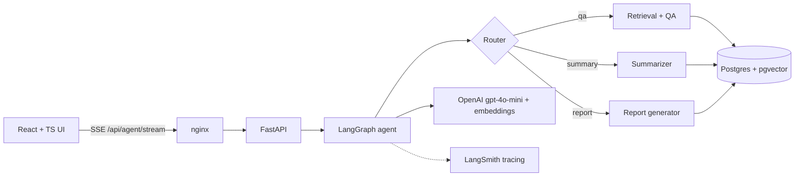
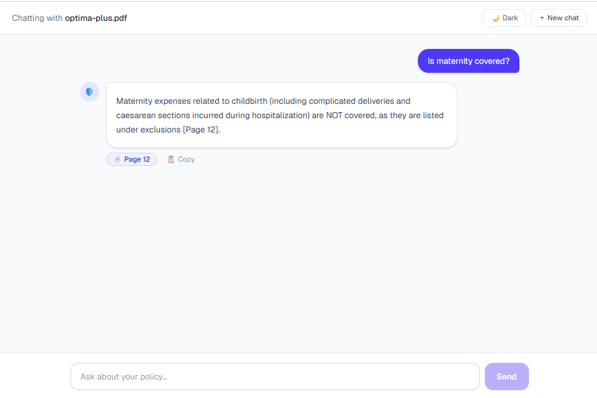
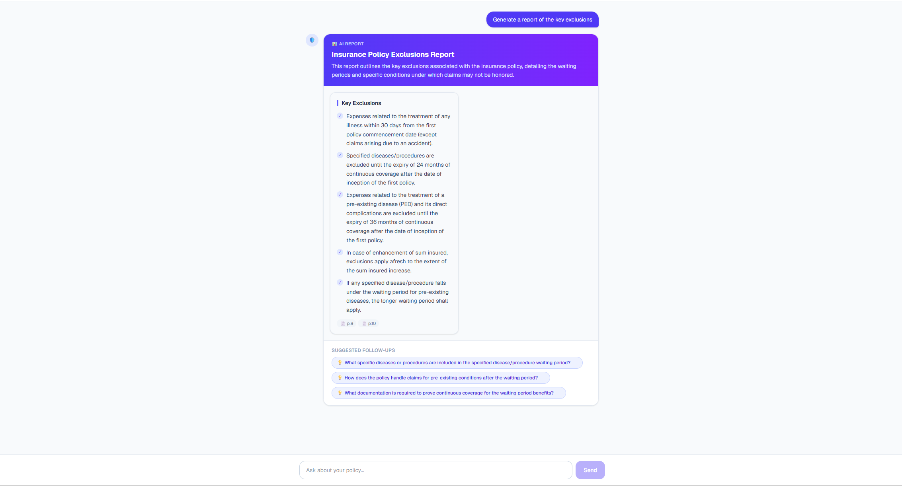

# PolicyPilot AI 🛡️


Agentic RAG app for insurance/health policy PDFs: upload a policy, chat with it, get **page-cited answers**, and generate **AI summary reports** with dynamic layouts and follow-up suggestions.


## Features
- Upload PDFs, pick a document, and chat with streaming answers and `[Page N]` citations
- LangGraph agent routes each question to Q&A, a summary or a structured report
- Reports render as bullets, tables or key-value layouts, with follow-up question chips
- Answers only from the uploaded document, and refuses off-topic questions
- Rate limited per client IP; CI/CD auto-deploys to AWS EC2

## Architecture


## Tech stack
| Layer | Tech |
|---|---|
| Frontend | React, TypeScript, Vite, SSE streaming |
| Backend | Python 3.12, FastAPI, uv, slowapi |
| AI | LangChain, LangGraph, OpenAI |
| Vector DB | ChromaDB (local) → PostgreSQL + pgvector |
| Quality | pytest, RAGAS, LangSmith |
| DevOps | Docker, docker compose, nginx, GitHub Actions, AWS EC2 |

## Evaluation (RAGAS, 16 Q&A from a public policy PDF)
| Stage | Page hit | Faithfulness | Answer relevancy | Context recall |
|---|---|---|---|---|
| Baseline | 0.69 | 0.62 | 0.57 | 0.62 |
| k=6, min score 0.2 | 1.00 | 0.91 | 0.71 | 0.85 |
| Text cleaning + 800/150 chunks | 1.00 | 0.96 | 0.81 | 0.95 |
| pgvector | 1.00 | 0.90 | 0.81 | 0.95 |

Off-topic refusal 2/2, router accuracy 5/5.

## Screenshots
| Chat with citations | Report |
|---|---|
|  |  |

## Run locally
```bash
cp backend/.env.example backend/.env   # add your OPENAI_API_KEY
docker compose up --build
# UI: http://localhost:5173  API docs: http://localhost:8000/docs
```

## Key engineering decisions
- **Eval-driven tuning:** used RAGAS scores to pick chunk size, k and score threshold
- **Streaming:** LangGraph `stream_mode=["messages","updates"]` turned into typed SSE events (a TS discriminated union)
- **Swappable vector store:** a `VECTOR_BACKEND` env switch between Chroma and pgvector
- **Prod setup:** nginx proxies `/api` with buffering off for SSE; only port 80 is public

> Uses only public sample policy documents.